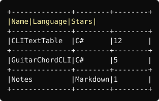
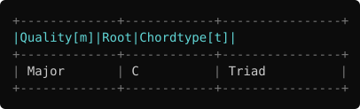
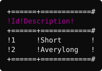
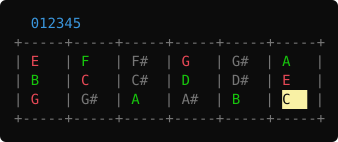
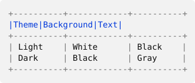

# CLITextTable

Mała biblioteka .NET do rysowania tabel tekstowych w konsoli, z kolorami wierszy i pojedynczych komórek.

Powstała jako część [GuitarChordCLI](https://github.com/SebastianEagler/GuitarChordCLI) (rysowanie gryfu gitary i menu).

## Wymagania
- .NET 9

## Przykład
```csharp
using CLITextTable.CliTable;
using CLITextTable.Configuration;

using var table = new CliTable(options =>
{
    options.MinCellDataWidth = 6;
    options.DrawHeaderLine = true;
    options.DrawRowLines = false;
    options.DefaultHeaderColor = ConsoleColor.Yellow;
    options.DefaultRowColor = ConsoleColor.Gray;
    options.DefaultRowLineColor = ConsoleColor.DarkGray;
}, ["Name", "Value"]);

table.AddStringRow(new List<string> { "Root", "C" });
table.AddStringRow(new List<string> { "Scale", "Major" });

// Color every cell whose text equals one of the given values.
table.ColorCells(new List<string> { "C" }, new CellColorOptions { Color = ConsoleColor.Red });

// Color a single cell: column 1, row 1.
table.SetColor(1, 1, ConsoleColor.Green);

table.Print();
```

## Przykładowe tabele
Pełny kod przykładów jest w [examples/CLITextTable.Examples/Program.cs](examples/CLITextTable.Examples/Program.cs). Uruchomienie (tabele pojawią się w konsoli, a obrazki poniżej zostaną odświeżone w `docs/images`):
```
dotnet run --project examples/CLITextTable.Examples
```

**1. Podstawowa tabela (linie pod każdym wierszem)**



**2. Kompaktowa tabela (bez linii wierszy, z odstępami wokół separatorów)**



**3. Własne znaki ramki i ograniczenie szerokości komórek (`MaxCellDataWidth`)**



**4. Kolorowanie komórek (`ColorCells`, `SetColor`)** - fragment gryfu gitary; nuty skali na zielono, akord C (C, E, G) na czerwono, jedna komórka czarna na żółtym



**5. Jasne tło (`DefaultBackgroundColor`)**



### Własne wyjście (`ICliOutput`)
`table.Print()` pisze do konsoli, ale `table.Print(ICliOutput)` pozwala wyrenderować tabelę gdziekolwiek. Obrazki powyżej powstały właśnie tak: klasa [SvgOutput](examples/CLITextTable.Examples/SvgOutput.cs) zbiera tekst z kolorami i zapisuje SVG.
## Opcje (`CliConfigureOptions`)
| Opcja | Znaczenie | Domyślnie |
|---|---|---|
| `ColumnSeparator`, `RowSeparator`, `FrameConnector` | znaki ramki | `\|`, `-`, `+` |
| `DrawHeaderLine` | linia nad nagłówkiem | `true` |
| `DrawRowLines` | linia pod każdym wierszem | `true` |
| `MinCellDataWidth`, `MaxCellDataWidth` | minimalna i maksymalna szerokość komórki | 3, 64 |
| `RowSeparatorMarginLeft`, `RowSeparatorMarginRight` | odstępy wokół separatora | 0, 0 |
| `DefaultHeaderColor`, `DefaultRowColor`, `DefaultRowLineColor` | kolory tekstu | White |
| `DefaultBackgroundColor` | tło całej tabeli (np. jasny motyw) | Black |

## Budowanie i testy
```
dotnet build
dotnet test
```

## Użycie w innym projekcie
Do czasu publikacji pakietu NuGet dodaj referencję do projektu:
```xml
<ProjectReference Include="..\CLITextTable\src\CLITextTable\CLITextTable.csproj" />
```

## Licencja
MIT, zobacz [LICENSE](LICENSE).
